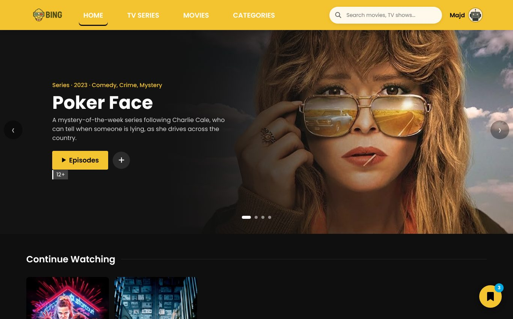
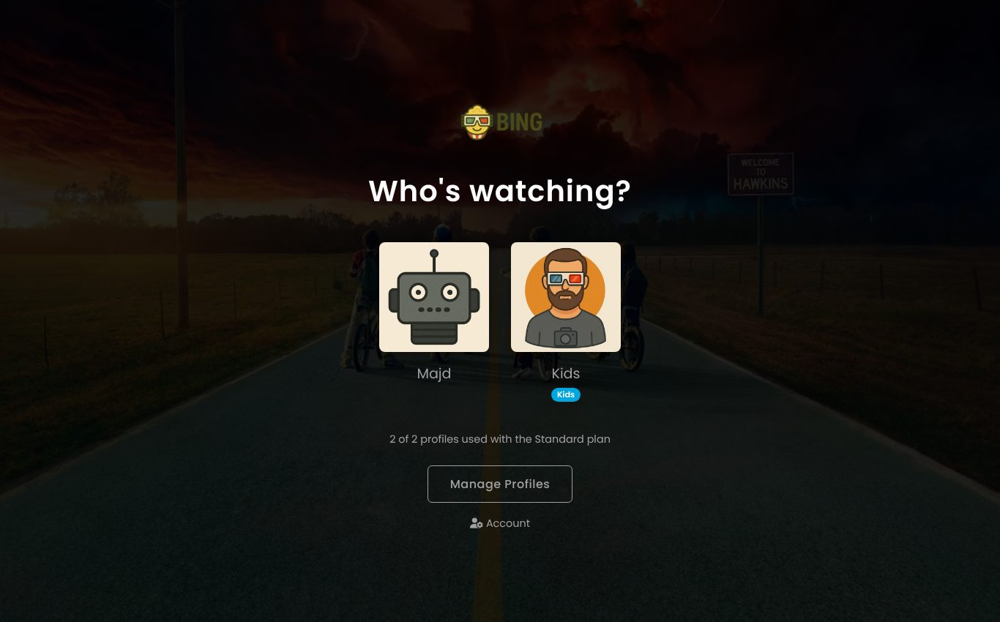
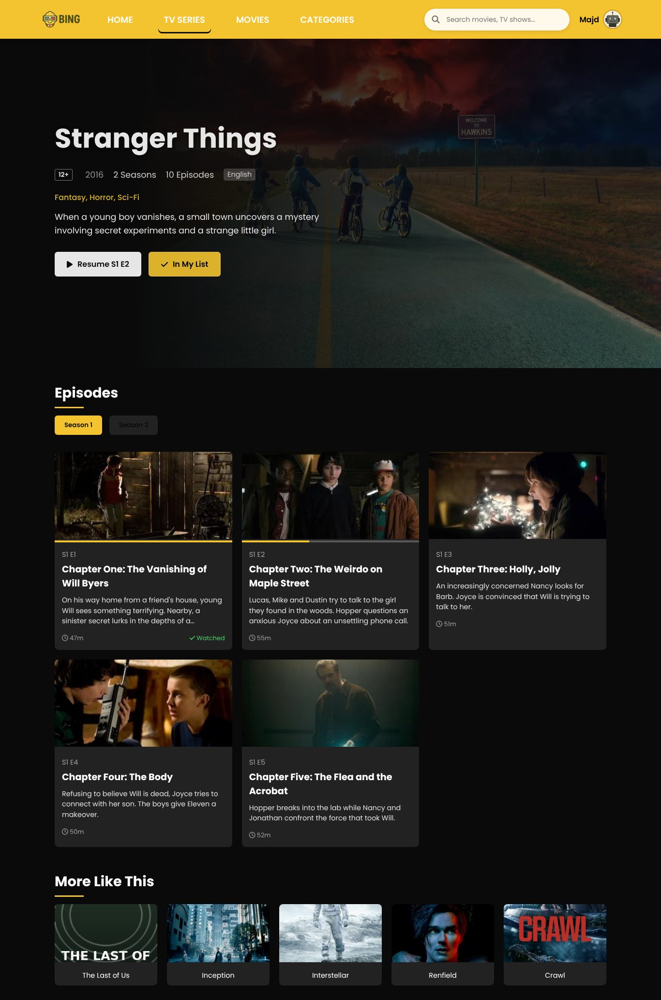
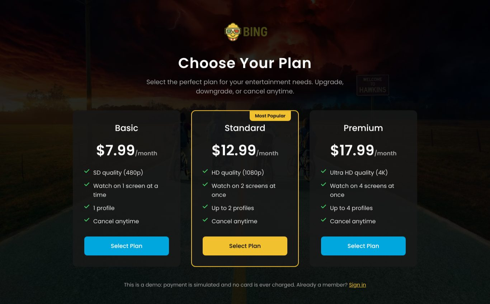
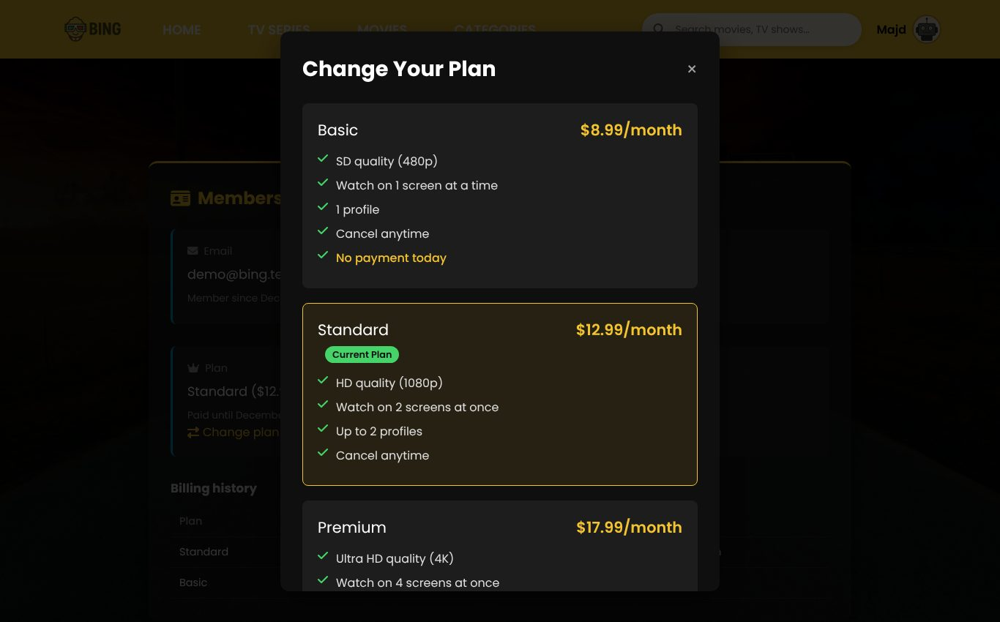
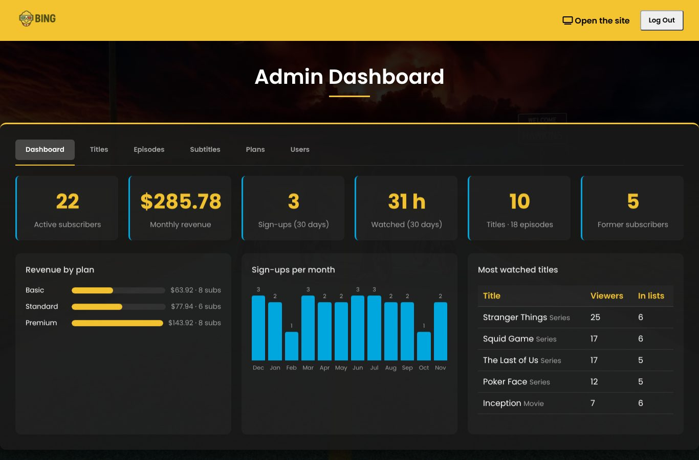

# BING : plateforme de streaming vidéo (PHP, SQLite)

Site de streaming de type Netflix, développé en **PHP 8 sans framework** avec une base **SQLite**, du **JavaScript** natif et du **CSS**. On s'inscrit en choisissant une offre, on crée plusieurs profils (dont des profils enfants), on regarde des films et des séries et on reprend la lecture là où on l'avait laissée. Un **tableau de bord d'administration** donne les indicateurs clés et permet de gérer le catalogue.

Projet de développement web de Licence 2 Informatique (Université Jean Monnet, Saint-Étienne). Il utilise le modèle de données de mon projet de base de données [streaming-sql](https://github.com/Majdch26/streaming-sql).



| Profils | Série | Lecture |
|---|---|---|
|  |  |  |

| Offres | Changement d'offre | Administration |
|---|---|---|
|  |  |  |

## Fonctionnalités

**Pour les abonnés**
- **Inscription en 3 étapes** : choix de l'offre, création du compte, paiement simulé. Le numéro de carte est vérifié avec l'algorithme de Luhn et la date d'expiration est contrôlée.
- **Profils** : jusqu'à 4 selon l'offre, avec un avatar. Un profil avec un âge ne voit que les titres autorisés pour cet âge, partout : accueil, recherche, catégories et liens directs.
- **Accueil** : carrousel des nouveautés et rangées *Continue Watching*, *Popular on BING*, *My List*, *New Releases*, films et séries.
- **Lecture** avec le lecteur Plyr :
  - la position est enregistrée toutes les 10 secondes, et la lecture reprend au même endroit ;
  - sous-titres en plusieurs langues ;
  - compte à rebours vers l'épisode suivant.
- **Séries** : épisodes par saison, barre de progression et mention « Watched » par épisode. Le bouton principal propose de reprendre l'épisode en cours ou de passer au suivant.
- **Recherche instantanée** par titre ou par genre, et **filtres par genre** (un titre peut avoir plusieurs genres).
- **Ma liste** : ajout et retrait en un clic, sans recharger la page.
- **Compte** :
  - changement d'offre : une offre plus chère se paie au prorata des jours restants ; pour une offre moins chère, le site indique d'abord quels profils seront supprimés ;
  - historique de facturation et derniers titres regardés ;
  - changement de mot de passe et suppression du compte.

**Pour l'administrateur**
- **Tableau de bord** :
  - abonnés actifs, revenu mensuel, inscriptions et heures regardées sur 30 jours, anciens abonnés ;
  - revenu par offre, inscriptions par mois et titres les plus regardés.
- **Gestion** des titres (avec leurs genres et leur âge minimum), des épisodes, des sous-titres, des offres et des utilisateurs.

## Lancer le site

Il faut **PHP 8.1 ou plus** avec l'extension `pdo_sqlite`, déjà incluse dans la plupart des installations (sur macOS : `brew install php`).

```bash
git clone https://github.com/Majdch26/bing-streaming
cd bing-streaming
php -S localhost:8000 router.php
```

Ensuite, ouvrir http://localhost:8000. Au premier lancement, la base `data/bing.sqlite` est créée automatiquement à partir de `database/schema.sql` et `database/demo.sql`.

| Compte | Email | Mot de passe |
|---|---|---|
| Abonné (Standard, 2 profils) | `demo@bing.test` | `Demo1234!` |
| Administrateur | `admin@bing.test` | `Admin1234!` |

Pour le paiement simulé, utiliser la carte `4242 4242 4242 4242`, une date d'expiration future et n'importe quel CVV.

Le site fonctionne aussi dans un sous-dossier d'Apache (XAMPP, MAMP…) : les fichiers `.htaccess` y bloquent l'accès aux dossiers internes. Pour repartir de zéro, il suffit de supprimer `data/bing.sqlite`.

## Base de données

Le schéma reprend celui du projet [streaming-sql](https://github.com/Majdch26/streaming-sql), adapté à SQLite :
- **13 tables** : catalogue, catégories, offres, abonnements datés, profils, favoris, historique de visionnage…
- **2 vues** : `v_catalogue` et `v_abonnement_courant`.
- **7 déclencheurs**, qui appliquent les règles de gestion :
  - le nombre de profils est limité par l'offre ;
  - deux abonnements d'un même utilisateur ne peuvent pas se chevaucher ;
  - un enfant ne peut ni regarder ni mettre en favori un titre interdit à son âge ;
  - une vidéo est soit un film, soit une série, et son type ne change plus ensuite.

Toutes les requêtes passent par des requêtes préparées (PDO).

## Sécurité

| Risque | Protection |
|---|---|
| Injection SQL | Requêtes préparées partout. Les caractères `%` et `_` sont échappés dans la recherche |
| Faille XSS | Tout ce qui est affiché est échappé (`e()` en PHP, `echapper()` en JavaScript) |
| Faille CSRF | Jeton secret sur chaque formulaire et chaque appel en JavaScript. La déconnexion se fait en POST |
| Accès aux données d'un autre compte | Chaque profil et chaque action sont vérifiés côté serveur avec l'identifiant du compte connecté |
| Mots de passe | `password_hash` (bcrypt). Le mot de passe ne repasse jamais par la page de paiement. Session régénérée à la connexion |
| Fichiers internes | La base SQLite, les scripts SQL et le code partagé ne sont pas servis (`router.php` et `.htaccess`) |
| Administration | Toutes les actions sont réservées aux administrateurs et vérifiées côté serveur |

## Tests

```bash
php tests/test_database.php      # 39 tests : déclencheurs, contraintes, vues, changements d'offre
pip install playwright && playwright install chromium
python3 tests/test_site.py       # 75 tests de bout en bout dans un vrai navigateur
```

Les tests de bout en bout lancent le site avec une base temporaire et refont le parcours complet : inscription, paiement, profils, Ma liste, recherche, reprise de lecture, contrôle d'âge, changements d'offre, mot de passe, administration et suppression du compte. Ils vérifient aussi les protections : pages réservées, CSRF, XSS, accès au profil d'un autre compte et fichiers internes. `python3 tests/test_site.py --captures` régénère les captures d'écran de ce README.

## Organisation du code

```
index.php, movies.php, series.php, serie.php, watch.php, genre.php   catalogue et lecture
login.php, pricing.php, signup.php, payment.php, success.php        connexion et inscription
profiles.php, account.php, help.php                                  profils, compte, aide
api/            search.php, favorite.php, progress.php               appels JavaScript (JSON)
admin/          index.php                                            tableau de bord et gestion
includes/       bootstrap.php (base, session, CSRF, accès), layout.php, navbar.php, catalogue.php
database/       schema.sql, demo.sql
css/, js/       styles et scripts de chaque page
vendor/         Font Awesome, Plyr et la police Poppins, servis en local
tests/          test_database.php, test_site.py
```

## Corrections par rapport à la version rendue

La [première version du dépôt](../../tree/07b392b) contient le projet tel qu'il a été rendu, sans les données personnelles. Voici ce qui ne marchait pas :

| Problème de la version d'origine | Correction |
|---|---|
| Après le choix d'un profil, le site redirigeait vers `home.php`, une page qui n'existait pas | Redirection vers l'accueil |
| `admin/get_user.php` et les autres fichiers `get_*.php` renvoyaient sans connexion toutes les données d'un utilisateur, y compris l'empreinte de son mot de passe | Fichiers supprimés. L'administration est entièrement réservée aux administrateurs |
| Aucune protection CSRF : une autre page pouvait vider la liste ou supprimer un profil à l'insu de l'utilisateur | Jeton CSRF partout |
| On pouvait choisir le profil d'un autre compte en modifiant le formulaire | Le profil est vérifié côté serveur |
| Le mot de passe passait en clair dans un champ caché de la page de paiement | Le mot de passe est haché dès l'inscription |
| Injection SQL possible dans l'administration (identifiant concaténé dans la requête) | Requêtes préparées |
| Les résultats de recherche étaient insérés dans la page sans échappement (XSS) | Échappement |
| Les clés étrangères de SQLite n'étaient pas activées : des profils restaient sans compte | `PRAGMA foreign_keys = ON` |
| Liens vers des pages inexistantes (`category.php`, `forgot-password.php`) et genres du menu sans contenu | Menu construit à partir de la base |
| Erreur JavaScript sur l'accueil (`videos` non défini) qui bloquait le carrousel | Script réécrit |
| Faux pourcentages « % Match » tirés au hasard et âge « 16+ » écrit en dur | Âge minimum réel de chaque titre |
| Une seule catégorie par titre, durées d'épisodes incohérentes (secondes et minutes) | Plusieurs genres par titre, durées en minutes |
| Dates d'abonnement partagées par tous les abonnés d'une offre, et prix différents entre les pages | Table `abonnement` avec ses propres dates et le prix payé |
| Écran de chargement artificiel d'une seconde et demie sur chaque page | Supprimé |
| Images, polices et icônes chargées depuis d'autres sites (17 Mo d'avatars) | Ressources locales, images compressées (1,4 Mo) |

Ajouts : reprise de la lecture, profils enfants, sous-titres, prorata des changements d'offre, tableau de bord avec indicateurs, suppression du compte, tests automatiques.

## Crédits

- Vidéos d'exemple : films libres de la fondation Blender (*Sintel*, *Big Buck Bunny*, *Elephants Dream*, *Tears of Steel*, sous licence Creative Commons) et extraits d'exemple hébergés par Google.
- Les affiches et images des films et séries appartiennent à leurs ayants droit. Elles servent uniquement à illustrer ce projet étudiant.
- [Font Awesome Free](https://fontawesome.com) (licences CC BY 4.0, SIL OFL et MIT), [Plyr](https://github.com/sampotts/plyr) (MIT) et la police [Poppins](https://fonts.google.com/specimen/Poppins) (SIL OFL).

Projet réalisé par **Majd CHAMAS**.
